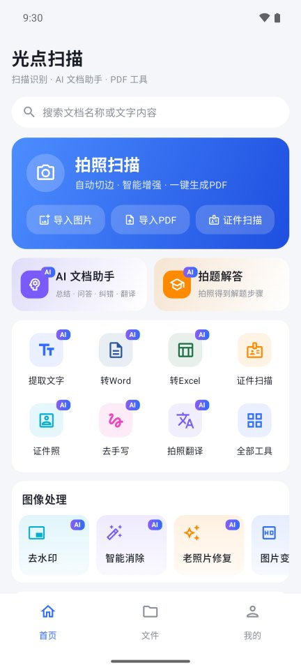
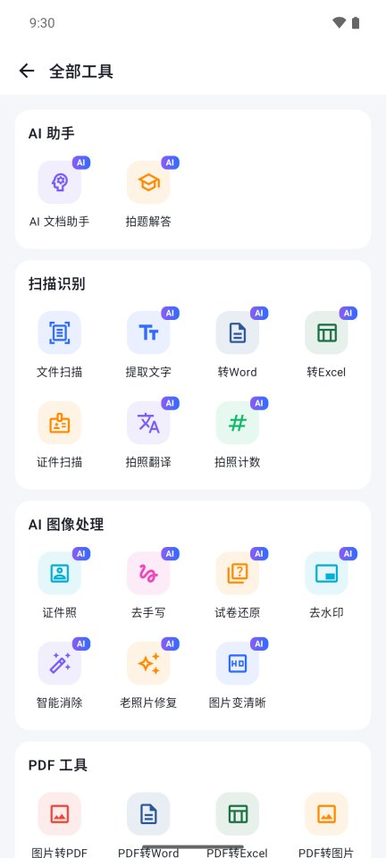
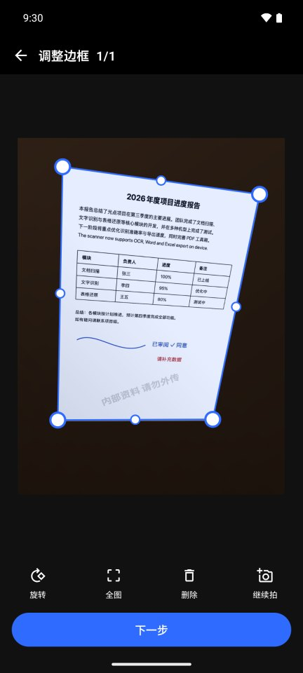
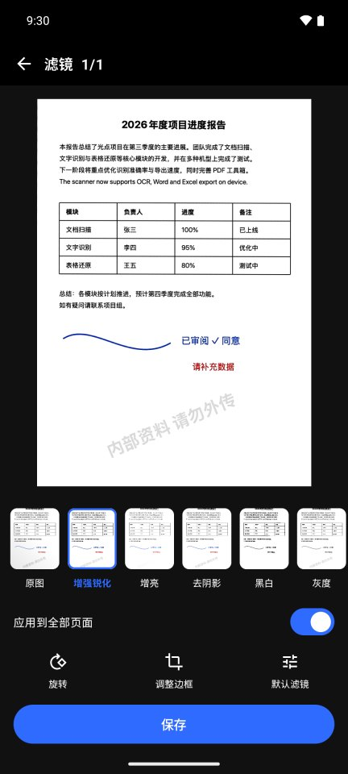
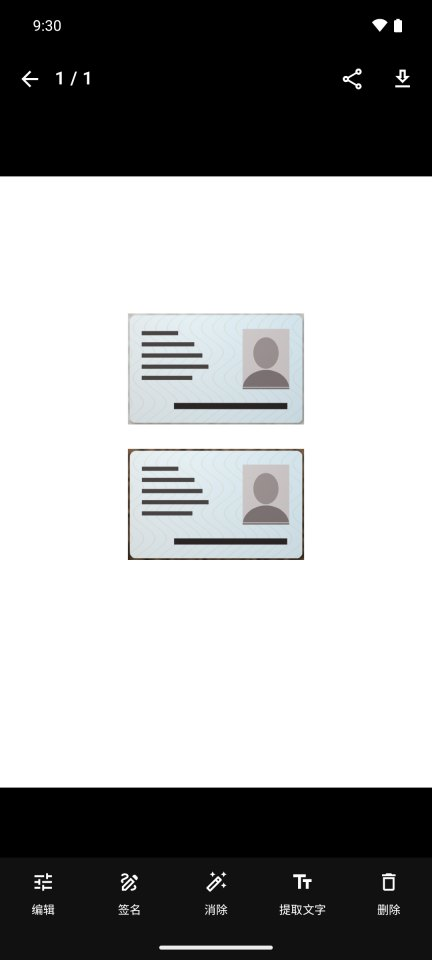
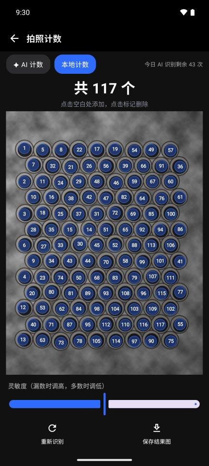
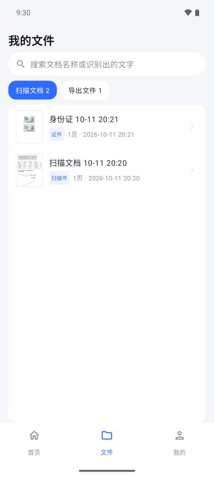
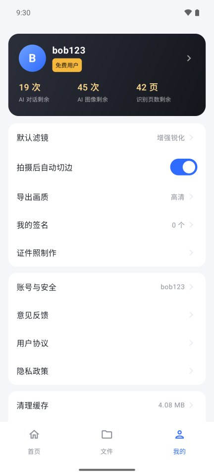

# 光点扫描（LumiScan）

一个对标「夸克扫描王」的 Android 扫描应用，**联网使用，需要注册登录**。扫描、裁剪、滤镜、PDF 工具在手机上完成，扫描的文档保存在本机；文字识别、转 Word/Excel、翻译、拍照计数、证件照、去手写、去水印、智能消除、老照片修复、图片变清晰、AI 文档助手和拍题解答通过自有后端调用阿里云百炼大模型（首页和工具图标右上角带 **AI** 角标的就是），按用户分组提供每日额度。图像类 AI（证件照、老照片修复、变清晰）默认先给出免费的本地结果，用户点「AI」才调用模型，避免打开就产生费用。AI 不可用（断网、额度用完、分组未开通）时自动改用手机上的算法，并提示原因。后端与管理后台见 [server/README.md](server/README.md)。

> 本项目是独立实现，不使用、不破解夸克的任何服务、接口或素材。应用名与图标均为原创。

## 截图

| 首页 | 全部工具 | 调整边框 | 滤镜 |
|:---:|:---:|:---:|:---:|
|  |  |  |  |
| **证件扫描（正反面排到 A4）** | **拍照计数** | **我的文件** | **我的** |
|  |  |  |  |

截图来自 Android 模拟器（连接本地测试服务器），示例照片是 `tools/testdata/` 生成的合成图。

## 下载

安装包在 [Releases](../../releases)：绝大多数手机装 `arm64-v8a`，老的 32 位手机装 `armeabi-v7a`，不确定就装 `universal`。需要 Android 10 及以上。

## 功能一览

| 类别 | 功能 | 实现要点 |
|---|---|---|
| 账号 | 注册 / 登录 / 退出、修改昵称邮箱密码、注销账号、意见反馈 | 首次启动先展示隐私政策并取得同意；登录后才能使用；被封禁、在其他设备挤下线或 token 过期时自动回到登录页并提示原因 |
| | 用户分组与 AI 额度 | 「我的」页显示分组、有效期，今日剩余的 AI 对话次数、AI 图像次数、识别页数，以及本月 Tokens；公告与强制/可选更新由后台下发 |
| AI | AI 文档助手 | 拍摄或从文档/识别结果进入：总结要点、纠错润色、翻译、提炼待办、多轮问答；超出单次字数自动截取并提示 |
| | 拍题解答 | 拍题 → 裁剪 → 视觉大模型给出步骤和答案，可继续追问 |
| | AI 翻译 | 识别结果页的翻译优先走 AI（无需下载语言包），失败或额度用完时回退到离线 ML Kit |
| 扫描 | 文件扫描（多页连拍 / 相册导入） | CameraX 实时边框检测 → 可拖拽四角 + 边中点的裁剪（带放大镜）→ 透视矫正（按相机模型还原纸张真实长宽比）；翻开的书本/小册子对页伸出画面时，边框停在中缝（折痕）处，只框完整的那一页 |
| | 相机 | 前后摄像头切换（证件照默认前置，自拍照片不镜像）、3/10 秒定时、音量键拍照、点按对焦、双指变焦、闪光灯/常亮，单张工具重拍会替换上一张 |
| | 7 种滤镜：原图 / 增强锐化 / 增亮 / 去阴影 / 黑白 / 灰度 / 省墨 | 背景归一化去阴影、色阶、USM 锐化、自适应二值化 |
| | 证件扫描：身份证、银行卡、驾驶证、户口本、护照、营业执照 | 证件四条边按边缘逐条拟合，角点取直边交点（不受圆角影响），四周留约 0.8 mm 余量，边缘不会被裁掉；浅色证件放在浅色桌面上也能识别；没识别到边框时以取景框为准。卡片类证件不做书本中缝裁切。正反面按真实尺寸（300dpi）排到一张 A4 |
| 识别 | 提取文字（中英混排）**AI** | 百炼 qwen3.5-ocr 识别，结果页标「AI 识别」；可编辑、复制、导出 TXT/Word。回退：ML Kit 离线模型 + 阅读顺序重排 + 智能分段 |
| | 转 Word **AI** | qwen3.5-ocr 文档解析：标题、段落、表格（含合并单元格）、居中/右对齐；可附带原图。回退：本地版面分析 |
| | 转 Excel **AI** | 文档解析直接给出单元格和合并信息，一页多张表依次排列；单元格可编辑。回退：有框线按网格线、无框线按文字布局聚类 |
| | 拍照翻译 **AI** | 识别后整页走 AI 翻译并把译文贴回原图；13 种目标语言。回退：ML Kit 离线翻译 |
| | PDF 转 Word/Excel/文字、文档导出 Word/Excel/TXT | 扫描页同样先走 AI 识别；一批里有一页失败后，其余页面改用本地识别 |
| | 拍照计数 **AI** | qwen3-vl-plus 逐个标出物体中心，可写明要数什么（如"钢管"）；结果可点按增删，可保存带编号的结果图。回退/本地计数：多尺度 LoG 斑点检测，自动判断物体大小和明暗，适应光照不均、木纹背景、粘连物体和铺满画面的钢管/钢筋端面 |
| 图像处理 | 证件照 **AI** | AI 抠图：qwen-image-3.0-pro 把背景换成纯绿（构图不变），手机再抠图，发丝自然；可换装（男士/女士西装、白衬衫）。换底（白/蓝/红/灰/渐变）、12 种规格、美颜、6 寸排版冲印在本地完成。回退：ML Kit 人像分割 + 按颜色修边 |
| | 去手写 / 试卷还原 **AI** | qwen3-vl-plus 找出手写内容（含黑色签字笔、签名、批注）的位置，手机只在这些区域内去除笔迹，**印刷文字不经过生成模型、不会被改写**；也可另去全部蓝/红笔迹、手动涂抹；试卷模式黑白净化 |
| | 去水印 **AI** | qwen3-vl-plus 定位水印，只把水印像素换成纸色。回退：整页浅色水印去除 |
| | 智能消除 **AI** | 涂抹要去掉的物体 → qwen-image-3.0 补全背景，只把涂抹区域贴回原图，其他像素不变；AI 结果与原图对不齐（模型移动了画面）时改用本地消除。回退：多尺度 Telea 修复 |
| | 老照片修复 **AI** | qwen-image-3.0 去划痕折痕、修复褪色，可选「智能上色」或「保持原色调」。回退：去噪、霍夫直线划痕修复、偏色校正 |
| | 图片变清晰 **AI** | 万相 wanx2.1-imageedit 超分辨率。回退：放大 + 细节增强 + 降噪 + 锐化 |
| PDF 工具 | 图片转 PDF、PDF 转 Word / Excel / 图片 / 长图 / 文字 | 文字层优先，扫描件自动 OCR |
| | 合并、拆分、页面管理（提取/删除/旋转）、压缩、加密、解密、加水印、签名、阅读 | PdfBox-Android；压缩只重编码图片、保留文字；签名为透明图层 |
| 文档管理 | 文档列表、全文搜索（含识别出的文字）、多选合并/删除/分享、页面排序、追加页面、单页重新裁剪/滤镜/签名/消除 | 本地文件存储 |
| 导出 | PDF（A4/原尺寸、画质、打开密码、平铺水印）、图片、长图、Word、Excel、TXT | 保存到 Download/光点扫描 或 Pictures/光点扫描，或系统分享 |
| 其他 | 手写签名（手写板，或拍下纸上的签名自动去背景导入）、默认滤镜、自动切边开关、导出画质、接收其他应用分享的图片/PDF | |

## 技术栈

- Kotlin 2.2 + Jetpack Compose（Material 3），minSdk 29，targetSdk 36
- CameraX 1.5（预览 + 拍照 + 实时分析）
- OpenCV 4.10（边框检测、透视、滤镜、修复、计数、表格线检测）
- ML Kit（全部为内置模型，无需 Google Play 服务）：中文文字识别、人脸检测、人像分割、离线翻译
- PdfBox-Android 2.0.27（PDF 编辑）；Word/Excel 由自写的 OOXML 生成器输出
- 网络：HttpURLConnection + kotlinx.serialization；信任系统 CA 与内置的服务器证书（IP 自签名证书）
- AI：阿里云百炼（通义千问 qwen3.5-ocr / qwen3-vl-plus / qwen-image-3.0(-pro)、万相 wanx2.1-imageedit），只经自有后端调用，App 里没有 API Key
- 后端：Kotlin + Ktor + SQLite，Docker 部署在 VPS，宝塔 nginx 反向代理（见 server/）

## 目录结构

```
app/src/main/java/com/lumiscan/app/
  data/        文档仓库（JSON + 图片文件）、设置、签名、登录账号（Account）
  data/remote/ 后端接口（Api）与证书校验
  imaging/     边框检测、透视/滤镜、去手写/水印/修复、计数、表格网格、A4 排版、水印
  ml/          OCR、版面还原、表格重建、翻译、证件照；CloudVision/Recognizer（云端 AI 识别与图像处理，失败回退本地）
  export/      Word/Excel 写入器、PDF 工具、导出、分享/保存
  scan/        拍摄会话（相机 → 裁剪 → 滤镜 → 各工具）
  nav/         轻量路由
  ui/          各页面（home / camera / crop / doc / recognize / tools / pdf / account / ai / common）
app/src/androidTest/   设备端流水线测试（含合成测试图）
app/src/test/          JVM 单元测试
tools/testdata/        生成测试图片的脚本（Swift；证件与计数测试图为 Python + OpenCV）
server/                后端与管理后台（Ktor + SQLite），deploy/ 下是部署脚本
```

## 构建与运行

需要 JDK 17 与 Android SDK（platform 36）。本机已有环境：

```bash
export JAVA_HOME=~/android-build/jdk/Contents/Home
```

```bash
./gradlew :app:assembleDebug
```

```bash
./gradlew :app:assembleRelease
```

App 连接的后端地址在根目录 `gradle.properties` 的 `lumiscan.apiBase`（当前为 `https://134.185.119.124`）。服务器证书内置在 `app/src/main/res/raw/server_cert.pem`，由 `server/deploy/gen-cert.sh` 生成。

产物位于 `app/build/outputs/apk/`，release 会按 ABI 拆分（arm64 约 43 MB、armv7 约 39 MB，另有通用包）。
release 目前使用 debug 签名以便直接安装测试，正式发布请在 `app/build.gradle.kts` 中换成自己的签名配置。

## 测试

```bash
./gradlew :app:testDebugUnitTest
```

```bash
./gradlew :app:connectedDebugAndroidTest
```

设备端测试覆盖：边框检测与真实长宽比还原、翻开书本的中缝识别（对页伸出画面 / 整个跨页 / 页内长竖线不误判）、7 种滤镜、中英文 OCR 与阅读顺序、表格网格精确还原、Word 版面、Excel 合并单元格、PDF 全套工具往返（合并/拆分/提取/删除/旋转/加解密/水印/压缩/签名/渲染）、去笔迹与去水印、证件边缘完整（深色/浅色桌面）、计数（药片、硬币、钢管、原木、钢筋 5 类实拍风格测试图）、老照片修复与 A4 排版。

## 已知限制

- AI 功能需要先在管理后台「系统设置」里填写百炼 API Key，未配置时 App 会提示"AI 服务尚未配置"并改用本地算法。
- 百炼会不定期下线旧模型（2026-10-10 下线了 qwen-image-edit 系列）。服务器遇到"模型不存在"会自动改用备用模型，后台概览会提示，「系统设置 → 检查模型是否可用」可随时核对。
- AI 去手写：笔迹压在印刷文字上（例如签名盖住打印的字）时，重叠处的印刷笔画可能变淡；本地模式（不用 AI）只能按**颜色**区分笔迹，黑色签字笔需要手动涂抹。
- AI 图像结果是模型重新生成的：证件照五官、老照片人物细节可能与原图略有差异，所以证件照只取 AI 的抠图结果、消除只贴回涂抹区域，老照片和超分则是整张替换。
- 图片变清晰（万相超分）输出约 100 万像素；原图更大时会缩回原尺寸，提升主要在小图和模糊图上。
- 后端目前用 IP + 自签名证书，正式上线建议换成域名和正式证书（步骤见 server/README.md）。
- 注册只有账号 + 密码，没有短信/邮箱验证；忘记密码需要管理员在后台重置。
- 离线翻译（AI 翻译不可用时的回退，以及拍照翻译页）首次使用某语言需从 Google 服务器下载约 30 MB 语言包（国内网络可能需要代理）。识别端支持中文与拉丁字母语言（英/法/德/西/意/葡/越）。
- 云同步（文档上传到服务器）、Office（Word/Excel/PPT）转 PDF 未实现；扫描的文档只保存在本机，卸载 App 会一起删除。
- 文字较小（每字低于约 30 像素）时 OCR 偶有错字；实拍时尽量让文档占满取景框。
- 本地计数对表面带图案的方形物体（如纸箱顶面）效果差，这类请用 AI 计数；AI 计数在数量很多（数百个）时可能漏数，可点按补上。
- 已在模拟器上用真实百炼模型验证：AI 提取文字、转 Word、去手写、去水印、智能消除、证件照（抠图 + 换装）、老照片修复、图片变清晰。AI 转 Excel 与拍照翻译走的是同一套已验证的接口，但未单独在设备上测试；AI 拍照计数只用模拟模型测过接口，尚未用真实模型验证准确度。
